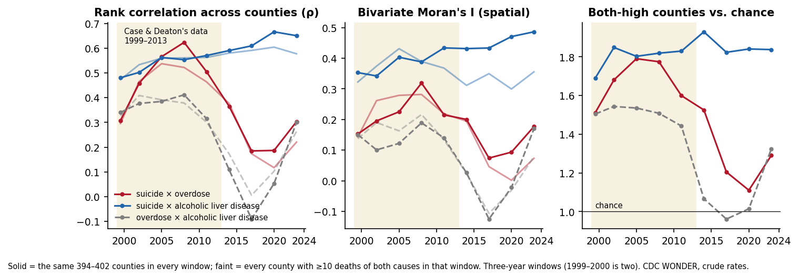
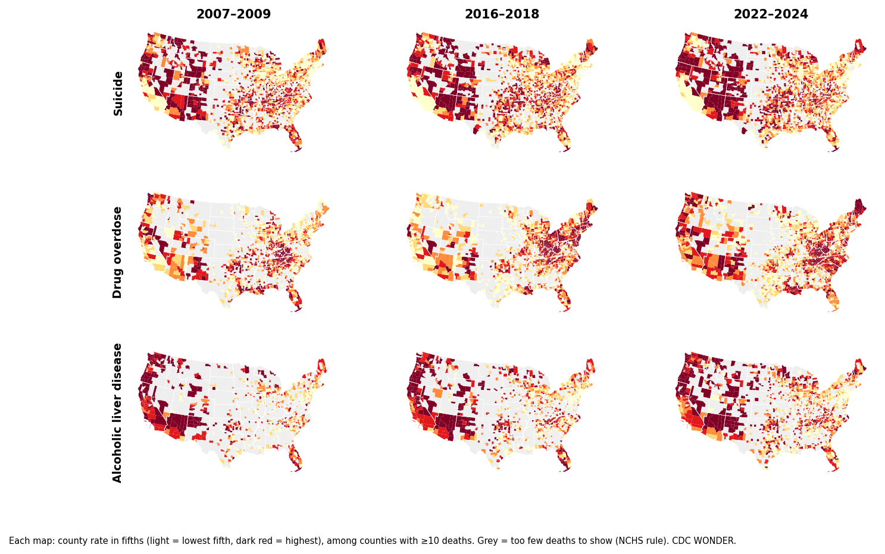
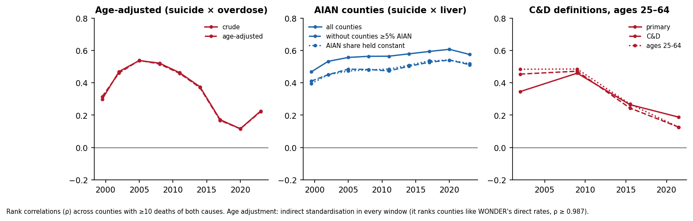
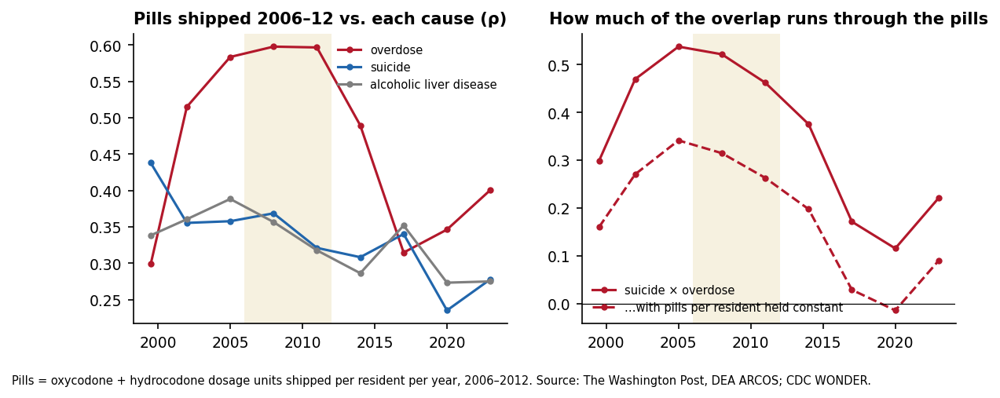
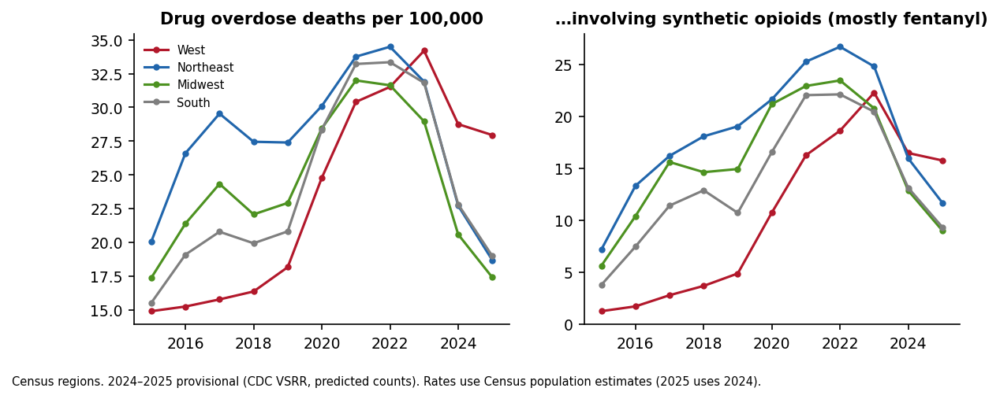
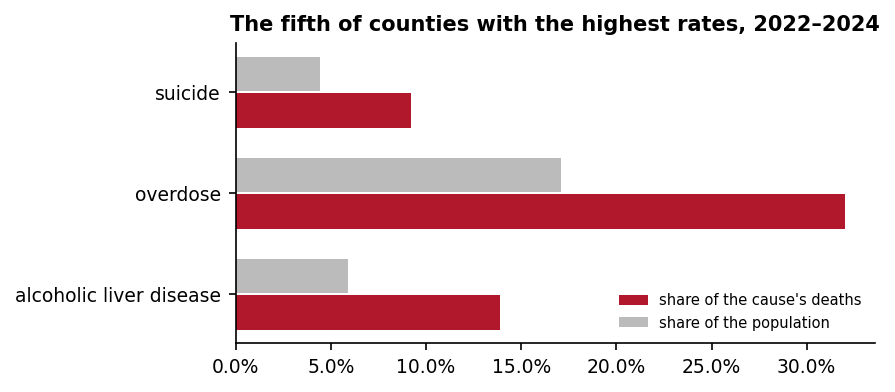
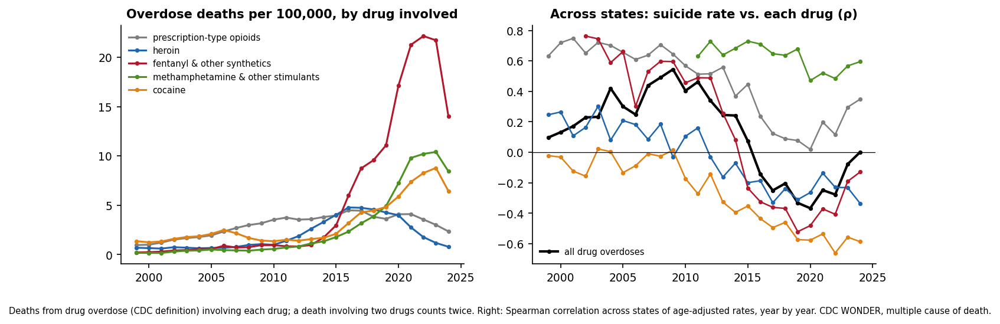

# Deaths of despair, revisited — findings (2026)

This is the write-up of the 2026 re-analysis on the `revisit-2026` branch. It is
written to be read slowly: each section says what question was asked, what was
done (with the statistics explained from first principles), what was found, how
sure we can be, and what it lets an essay say. Findings and interpretation are
kept apart. Where a result is consistent with more than one explanation, the
alternatives are named.

Everything here regenerates from the repository; see [Reproducing](#reproducing).

---

## 1. Summary

1. **The shared geography of suicide and overdose has a life cycle.** Across US
   counties, the correlation between suicide and drug-overdose death rates rose
   through the early 2000s, peaked in 2007–09, fell steeply after 2013, bottomed
   out in 2016–21, and partly rebounded in 2022–24 (Figure 1). The pattern holds
   under every check below: a fixed set of counties, spatial and non-spatial
   statistics, age adjustment, Case & Deaton's own definitions, and their
   working-age population.
2. **Suicide and alcoholic liver disease share geography in every window,**
   steadily, 1999–2024. A small part of that is age structure and a small part
   is counties with large American Indian and Alaska Native populations; most of
   it survives both adjustments.
3. **Overdose is the cause whose geography moves.** Its county pattern tracked
   where prescription pills were shipped in the pill era, pulled east when
   fentanyl entered the East's powder-heroin markets, and has moved west since
   2019. In 2023 the West became the census region with the highest overdose
   rate; in 2025 (provisional) its rate is about 50% above the other regions.
4. **Pills went where all three causes were high,** including suicide and liver
   disease before the pill era. Holding pill volume constant removes roughly two
   fifths of the pill-era suicide–overdose correlation and all of the weak
   remainder in 2016–21. These are associations; they cannot separate targeted
   marketing from shared risk factors.
5. **The April analysis's headline, "near-zero geographic correlation," came
   from pooling 2018–2024,** which averages the trough and the rebound, and from
   a sample rule that changed between windows. It also silently dropped
   Oglala Lakota County (Pine Ridge) and all of Connecticut.
6. **Each drug wave had its own relationship to the suicide map.** Across
   states, prescription-opioid deaths tracked suicide geography through the
   2000s (ρ 0.6–0.75); cocaine, heroin (from 2013) and fentanyl (from 2015) ran
   the opposite way (the East); methamphetamine tracked it throughout (the West). All overdoses
   together follow the same arc as the counties, year by year: ρ 0.54 with
   suicide in 2009, −0.37 in 2020, 0.00 in 2024.
7. **In Case & Deaton's window the overdose epidemic was disproportionately
   white; in the fentanyl years it was not.** The non-Hispanic white rate nearly
   tripled from 1999 to 2013 while the Black rate rose by about a third. From
   2015 the Black and American Indian rates rose far past the white rate (2022:
   47.5 and 63.5 against 35.6 per 100,000).

---

## 2. What was already known

Most of the building blocks are in the literature; the essay should cite them.

* **The causes behave differently over time:** Masters, Tilstra & Simon (2018,
  *IJE*); Tilstra, Simon & Masters (2021, *AJE*); the Joint Economic Committee
  (2019) on 45 years of trends.
* **Different county geographies:** Dwyer-Lindgren et al. (2018, *JAMA*);
  Shiels et al. (2020, *JAMA Netw Open*); Zhang & Monnat (2024,
  *SSM–Population Health*). Simon & Masters (2021, *AJE*) found county *changes*
  in the three causes, 1990–2017, essentially uncorrelated.
* **Overdose follows the drug supply:** Ruhm (2018, 2019); Currie & Schwandt
  (2021); Alpert, Evans, Lieber & Powell (2022, *QJE*: OxyContin marketing and
  triplicate-prescription states); Arteaga & Barone (2026, *QJE*: Purdue's early
  marketing counties); Evans, Lieber & Power (2019) and Powell & Pacula (2021)
  on the 2010 reformulation and the shift to heroin; Ciccarone (2017) and
  Zoorob (2019) on powder versus black-tar heroin markets; Shover et al. (2020)
  and Mattson et al. (2021, *MMWR*) on fentanyl moving west from 2019.
* **What Case & Deaton actually claimed.** Their 2015 evidence was that the
  three causes rose *together over time* among middle-aged white non-Hispanic
  Americans, in every census region. They never predicted county co-location;
  their 2020 book describes the split (overdose in Appalachia and the East,
  suicide in the Rocky Mountain states), and their 2022 review rejects the idea
  that different geographies disprove a common cause. They reject poverty as
  the driver, and they "largely agree" the overdose epidemic was supply-driven,
  adding that the industry targeted places already in pain. The phrase "deaths
  of despair" is not in the 2015 paper; Case coined it in an op-ed at the end of
  2015. Their definitions are broader than this analysis's (liver disease adds
  K73–K74; poisonings add alcohol poisoning).

**What appears to be new here:** a consistent 1999–2024 series of how strongly
the three causes share counties, window by window, including the 2022–24
rebound (no prior study found tracks this); a quantified supply link to that
co-location; and 2020–24 coverage, which most of the literature predates.

---

## 3. Data and methods

### Sources

| Data | Use | How it enters the repo |
|---|---|---|
| CDC WONDER, underlying cause of death, 1999–2020 (bridged race) and 2018–2024 (single race) | county and national death counts | 51 exports in `data/wonder/`, each carrying WONDER's echo of the exact query; `queries.json` lists every request |
| CDC WONDER, multiple cause of death, 1999–2020 and 2018–2024 | state deaths by drug; state suicide, liver and overdose series; 1999–2020 national tables by age and by race | 22 exports in `data/wonder/state/` and `national/`; its underlying-cause counts are the same death records as the underlying-cause database (checked on 2018–20) |
| Census county population estimates, 2000–2024 | age structure; American Indian share | fetched by `revisit/fetch.py`, pinned by SHA-256 |
| Census TIGER/Line 2020 county boundaries | neighbours for spatial statistics; maps | fetched, pinned |
| DEA ARCOS via The Washington Post, 2006–2014 | pills shipped per county | fetched, pinned; never committed (ODbL) |
| CDC VSRR provisional overdose counts, 2015–2026 | the most recent years by state and drug | dated snapshot in `data/cdc/` |

### Causes

| Name | ICD-10 underlying cause |
|---|---|
| suicide | X60–X84 |
| overdose | X40–X44, Y10–Y14 (accidental and undetermined-intent drug poisoning; intentional drug poisoning stays with suicide) |
| alcoholic liver disease | K70 |
| Case & Deaton "poisonings" (sensitivity) | X40–X45, Y10–Y15, Y45, Y47, Y49 |
| Case & Deaton liver (sensitivity) | K70, K73, K74 |

### Windows and samples

Nine non-overlapping windows: 1999–2000, then three-year windows to 2022–24.
WONDER withholds any county count between 1 and 9 ("suppressed"), and NCHS
forbids publishing counts or rates based on fewer than 10 deaths. So every
county-level result uses counties with **at least 10 deaths** of each cause in
the window. Two samples are reported:

* **window sample:** every county that qualifies in that window. It grows over
  time as overdose deaths rise and more small counties cross 10.
* **panel:** the same ~400 counties in every window (those that qualify in all
  nine). Changes in the panel cannot come from changes in who is counted. It
  is weighted toward larger counties.

### The statistics, from first principles

**Spearman's rank correlation (ρ).** Rank every county on each rate (1 = lowest)
and compute the ordinary correlation of the ranks. ρ = 1 means the two rates
put the counties in the same order; 0 means knowing one order tells you nothing
about the other. Ranks make it robust to the long right tails of rural rates.
This is the headline statistic because it answers the plain question, "do the
counties with high suicide rates also have high overdose rates?"

**Population-weighted Pearson (r_w).** An ordinary correlation of the rates
themselves, with each county weighted by its population, so large counties
count more. It answers the same question from the point of view of people
rather than counties.

**Bivariate Moran's I.** Compares each county's suicide rate with the average
overdose rate of its neighbours (counties that touch it, "Queen" contiguity).
It is the formal test of *spatial* co-clustering: do places with high suicide
sit among places with high overdose? Its p-value comes from a permutation test:
shuffle the overdose values across counties 999 times and see how often a
shuffled map produces an I as large as the real one. Caveat (Anselin): it
blends two things, the in-place correlation and the spatial spillover, so it is
reported next to Lee's L.

**Lee's L.** A spatial correlation that smooths *both* rates over each county
and its neighbours before correlating them, which separates "the same places"
from "nearby places." It moves with Moran's I here, so the conclusions do not
depend on which is used.

**Both-high ratio.** Split counties into thirds on each rate. If the two rates
were unrelated, one county in nine would land in the top third of both. The
ratio of the actual count to that expected count is a co-location index that
needs no statistics to read: 1.8 means 80% more both-high counties than chance.

**Age adjustment.** Older counties have more suicide and liver deaths per head
simply because they are older; overdose skews younger. Two methods:
WONDER's own *direct* age-adjusted rates (published for 1999–2020, counties with
≥20 deaths), and *indirect* standardisation (`revisit/agestd.py`): for each
county, expected deaths = its population in each ten-year age group × the
national death rate for that age group in the same window; the standardised
mortality ratio (SMR) = observed ÷ expected; the adjusted rate = SMR × the
national rate. Indirect standardisation is the standard tool for small areas
because it needs only the county's total deaths. Here it is the single method
for all nine windows (national age-specific deaths from WONDER, national and
county person-years from the Census estimates). Where WONDER also publishes
direct age-adjusted county rates (1999–2018), the two rank counties almost
identically: ρ 0.987–0.998 for each cause in each window checked.

**Partial correlation.** The correlation of two rates after removing the part
of each that a third variable (pill volume, American Indian share) accounts for.
If suicide and overdose share geography only because both follow the pills,
the partial correlation drops to zero.

---

## 4. Findings

### 4.1 The life cycle of co-location



| Window | 1999–00 | 01–03 | 04–06 | 07–09 | 10–12 | 13–15 | 16–18 | 19–21 | 22–24 |
|---|---|---|---|---|---|---|---|---|---|
| ρ, suicide × overdose, panel | 0.31 | 0.46 | 0.57 | **0.62** | 0.50 | 0.37 | 0.18 | 0.19 | 0.30 |
| ρ, suicide × overdose, window sample | 0.30 | 0.47 | 0.54 | 0.52 | 0.46 | 0.38 | 0.17 | 0.12 | 0.22 |
| Moran's I, suicide × overdose, panel | 0.15 | 0.20 | 0.23 | **0.32** | 0.22 | 0.20 | 0.07 | 0.09 | 0.18 |
| Both-high ratio, suicide × overdose | 1.51 | 1.68 | 1.79 | 1.77 | 1.60 | 1.53 | 1.20 | **1.11** | 1.29 |
| ρ, suicide × liver, panel | 0.48 | 0.50 | 0.56 | 0.55 | 0.57 | 0.59 | 0.61 | 0.67 | 0.65 |
| Both-high ratio, suicide × liver | 1.69 | 1.85 | 1.80 | 1.82 | 1.83 | 1.93 | 1.82 | 1.84 | 1.84 |
| ρ, overdose × liver, panel | 0.34 | 0.38 | 0.38 | 0.41 | 0.31 | 0.11 | −0.09 | 0.05 | 0.30 |

(`out/revisit/r02_life_cycle.csv`, `r06_overlap.csv`)

* **Rise and peak.** Suicide and overdose shared counties increasingly from
  1999 to a peak in 2007–09, the window in which all three causes co-located
  (overdose × liver disease also peaks then in the panel).
* **Decline.** Most of the fall happened between 2010–12 and 2016–18, the years
  in which prescription opioids gave way to heroin and then illicit fentanyl.
  Three-year windows cannot separate those two steps.
* **Trough.** In 2019–21 the window-sample Moran's I is 0.002 (p = 0.45) and the
  both-high ratio is 1.11: close to what unrelated maps would produce.
* **Rebound.** In 2022–24 every statistic rises again (panel Moran's I 0.18,
  p = 0.001). This is one window; final 2025 county data will show whether it
  continues.
* **The steady pair.** Suicide × liver disease sits near ρ 0.5–0.65 and 1.8×
  chance in every window.

The maps behind the numbers:



Suicide and liver disease keep their western pattern throughout. Overdose is
high in both the West and Appalachia in 2007–09, concentrates in Appalachia,
the Ohio valley and New England by 2016–18, and reappears across the Southwest
and Pacific states in 2022–24.

**Counties high on both.** The counties the original thesis went looking for
exist in every window. The states holding the most of them: Tennessee, Florida,
North Carolina, Kentucky and New Mexico in 2007–09; West Virginia, Kentucky,
Tennessee, Oklahoma and Indiana in 2016–18; Tennessee, Kentucky, New Mexico,
North Carolina and Virginia in 2022–24.

### 4.2 Robustness



| Check | Result | File |
|---|---|---|
| Exact reproduction of April | all eight published trajectory values reproduce to four decimals | `r01_consistency.csv` |
| One sample rule across windows | same shape; April's windows mixed rules (the 1999–2020 exports blank rates for 10–19 deaths, the 2018–24 export printed them) | `r01` |
| Fixed panel vs window sample | same shape (Figure 1) | `r02` |
| Spatial vs non-spatial statistics | Spearman, weighted Pearson, Moran's I and Lee's L all show it | `r02` |
| Age adjustment (one indirect method, all nine windows) | suicide × overdose moves by ≤ 0.015 in every window; suicide × liver drops by 0.04–0.05 (e.g. 0.59 → 0.55), so a small part of that pairing is age structure | `r04_age.csv` |
| Case & Deaton's definitions | suicide × "poisonings" 0.45 → 0.47 → 0.24 → 0.13 across four coarse windows | `r07_definitions.csv` |
| Ages 25–64 only | suicide × overdose 0.48 → 0.49 → 0.27 → 0.13 | `r07` |
| American Indian / Alaska Native counties | suicide × liver stays 0.41–0.54 without counties ≥5% AIAN, 0.40–0.54 with the share held constant (vs 0.47–0.61 all counties) | `r03_aian.csv` |
| Database switch in 2019 | the same years (2018–20) from both databases: identical suppression in all 3,061 counties, identical deaths in the 1,988 with published counts, identical populations | calibration exports |
| NCHS smoothed county overdose model | cannot resolve annual timing (county ranks move in three-year blocks); set aside | `r08_annual.csv` |

Two details worth knowing. Case & Deaton's "poisonings" include alcohol
poisoning, which by itself makes poisonings resemble liver disease (with their
definitions ρ 0.47 in 1999–2005, against 0.20 for drug overdose × K70). And the coarse
four-window view cannot show the 2022–24 rebound, because its last window pools
the trough with the rebound, which is also why the April analysis's 2018–24
window looked like independence.

### 4.3 The pill supply



Pills = oxycodone and hydrocodone dosage units shipped to pharmacies and
practitioners in each county, per resident per year, 2006–2012 (median county
34; top tenth above 64). (`r05_supply.csv`)

* **Overdose tracked the pills most closely during the pill era** (ρ 0.58–0.60,
  2004–12), less after (0.31 in 2016–18), with some return by 2022–24 (0.40).
* **The pills also went where suicide and liver disease were high,** before
  the pill era as well as during it (suicide ρ 0.44 in 1999–2000; liver
  0.32–0.39 through 2012).
* **Holding pills constant** lowers the suicide–overdose correlation from about
  0.52 to about 0.32 in 2004–09, and from 0.12–0.17 to about zero in 2016–21.

How to read this. The overlap of the pill era ran partly through the pill
supply and partly through something these data cannot name. The pre-period
correlation is consistent with Case & Deaton's reading (the industry targeted
places already in pain) and equally with shared risk factors that draw both
prescriptions and these deaths: rural and older populations, injury and
disability, fewer alternatives for pain. Distinguishing those needs the
literature (Alpert et al.; Arteaga & Barone) or data these files lack.

### 4.4 The fentanyl era by region



(CDC provisional counts; `r09_recent_waves.csv`)

* 2015–19: the West had the **lowest** overdose rate of the four census regions
  (15–18 per 100,000).
* 2023: the West had the **highest** (34.2).
* 2024–25: rates fell sharply in the other regions (to 17–19 in 2025) and much
  less in the West (27.9), which is now about 50% above them.
* Synthetic-opioid (mostly fentanyl) deaths in the West rose from 1.3 per
  100,000 in 2015 to 22.3 in 2023 (second to the Northeast), and have been the
  highest of any region since 2024.
* The West's share of all US overdose deaths rose from 17% (2017) to 31%
  (2025, provisional).

This is consistent with the county-level rebound in 2022–24 and suggests
co-location could rise further once final 2025 county data exist.

### 4.5 Where the deaths are



Rate maps show where risk is high. They are not a map of where most deaths
happen. The fifth of counties with the highest suicide rates hold about a tenth
of suicide deaths (and 4–6% of the population); for overdose the top fifth
holds 18–39% of deaths, depending on the window. (`r06_burden.csv`)

### 4.6 The drug waves, and which matched the suicide map



(State × year deaths from drug overdose involving each drug, CDC WONDER
multiple cause of death; `r11_waves.csv`, `r11_state_corr.csv`)

* **Nationally**, deaths involving prescription-type opioids rose steadily to
  about 4.5 per 100,000 (2016–17); heroin peaked in 2016 (4.8); fentanyl and
  other synthetics in 2022 (22.2); methamphetamine and other stimulants (10.4)
  and cocaine (8.8) in 2023. A death involving two drugs counts under both.
* **Across states, year by year**, the correlation of each drug's death rate
  with the suicide rate:
  * prescription-type opioids: 0.57–0.75 from 1999 to 2010, about 0 by 2020,
    0.35 in 2024;
  * heroin: weakly positive at most before 2013 (up to 0.30), negative since,
    reaching −0.34;
  * cocaine: near zero or negative throughout, reaching −0.66;
  * fentanyl and other synthetics: positive before 2013, when the numbers were
    small and mostly pharmaceutical fentanyl; −0.52 in 2019; −0.13 in 2024;
  * methamphetamine and other stimulants: 0.47–0.73 in every year with enough
    states to measure (2011–2024);
  * all drug overdoses together: 0.54 in 2009, −0.37 in 2020, 0.00 in 2024.

How to read this. States are large and mixed, so this is a coarse companion to
the county results, but it has annual resolution, and it shows the same arc.
The overlap of the pill era came with prescription opioids, whose deaths ran
high in the same states as suicide; the drugs of the next wave (heroin, then
fentanyl in the powder-heroin East, and cocaine) ran high in other states. The
methamphetamine series shows that part of the drug supply has always sat in
the suicide belt.

### 4.7 Who died

National age-adjusted rates, non-Hispanic groups (`r10_race.csv`; overdose uses
CDC's standard definition so it can be checked against CDC's published figures,
which it matches for 2022: Black 47.5, white 35.6).

| Overdose per 100,000 | 1999 | 2013 | 2017 | 2022 | 2024 |
|---|---|---|---|---|---|
| Non-Hispanic white | 6.0 | 17.6 | 27.5 | 35.6 | 24.7 |
| Non-Hispanic Black | 7.3 | 9.5 | 20.5 | 47.5 | 33.7 |
| Non-Hispanic American Indian / Alaska Native | 3.6 | 16.8 | 23.7 | 63.5 | 50.2 |

* **During Case & Deaton's window (1999–2013)** the white overdose rate nearly
  tripled while the Black rate rose by about a third: the rise they described
  was concentrated in the population they studied.
* **From 2015** the Black and American Indian rates climbed past the white rate.
  By 2022 they were 1.3 and 1.8 times it.
* American Indian and Alaska Native people also have the highest suicide rate
  (2021: 27.1 against 17.3 for white) and far higher alcoholic liver disease
  (2021: 62.3 against 9.3). Their rates are undercounts: death certificates
  misclassify many American Indian decedents as another race.

---

## 5. What changed since the April analysis

| April | Now |
|---|---|
| Four seven-year windows, two overlapping (2013–19, 2018–24) | nine non-overlapping windows |
| Sample rule changed between windows (published rates blank for 10–19 deaths before 2019) | one rule, rates recomputed from counts; plus a fixed panel |
| "Near-zero correlation" (Moran's I 0.016, p = 0.15) | a trough (2016–21) followed by a rebound (2022–24); pooling hid both |
| K70 pairs computed only on counties with all three causes | pairwise samples; the liver line's final dip disappears |
| Oglala Lakota County and Connecticut dropped (FIPS changes) | restored (Connecticut lacks WONDER populations after 2021) |
| Crude rates | crude and age-adjusted, which agree |
| Bayes factors of 236× and 520,000× | retired: they were driven by priors placing almost no weight at zero, and the site's chart drew different priors than the analysis |
| Tercile "regimes," altitude and gun proxies | not carried forward; the regimes are a classification, not a test, and the altitude and gun analyses do not bear on the two questions this revision asks |

---

## 6. Open items

* **Final 2025 county data** (expected around the end of 2026) will show
  whether the 2022–24 rebound continues; the provisional state data in §4.4
  suggest it might.
* **Hispanic people of all races** have no age-adjusted series here; that needs
  its own WONDER query (the tables are grouped by race within Hispanic origin).
* **County-level drug types** are too heavily suppressed to map by window; the
  drug waves are state-level only.

---

## 7. Claims ledger

For the essay. Strength reflects how many independent checks a claim survives
and whether it depends on one window.

| Claim | Evidence | Strength |
|---|---|---|
| Suicide and overdose increasingly shared counties through the 2000s, peaking in 2007–09. | §4.1; every check in §4.2 | strong |
| That overlap fell steeply after 2012 and was near chance by 2019–21. | §4.1–4.2 | strong |
| It partly rebounded in 2022–24. | one window, all statistics, consistent with §4.4 | moderate |
| Suicide and alcoholic liver disease share geography in every window. | §4.1–4.2 | strong |
| In 2007–09 all three causes co-located. | overdose × liver peaks then | moderate |
| Overdose geography tracked pill shipments most in the pill era. | §4.3 | moderate (association; the causal case rests on the literature) |
| Pills went disproportionately to counties already high in suicide and liver disease. | §4.3 | moderate association; cannot separate targeting from shared risk factors |
| About two fifths of the pill-era overlap runs through pill volume. | §4.3 partial correlations | tentative (crude supply measure) |
| Since 2023 the West has had the highest regional overdose rate. | §4.4 | strong (provisional for 2024–25) |
| Most suicide deaths occur outside the highest-rate counties. | §4.5 | strong (descriptive) |
| Prescription-opioid deaths ran high in the same states as suicide in the 2000s; heroin, cocaine and fentanyl did not. | §4.6 | strong (state level) |
| Methamphetamine deaths track the suicide geography. | §4.6 | moderate (state level, 2011–24) |
| In 1999–2013 the overdose rise was concentrated among white Americans; from 2015 Black and American Indian rates rose past it. | §4.7 | strong |
| Case & Deaton predicted county co-location. | §2 | **not supported**: they did not |
| Economic distress causes (or does not cause) these deaths. | — | **not testable here** |

---

## 8. Limitations

* **Ecological data.** Counties, not people. Nothing here says that any
  individual's death had one cause or another, and correlations across counties
  can differ from those across people.
* **Suppression.** Counties below 10 deaths are excluded, so the smallest
  counties, many in the Plains and Mountain West, are missing; the panel leans
  toward larger counties.
* **Measurement.** K70 undercounts alcohol deaths (alcohol elsewhere on the
  certificate is missed); states code undetermined-intent deaths differently;
  American Indian and Alaska Native deaths are misclassified as other races on
  some certificates (this does not affect all-race county totals).
* **The pill measure** covers oxycodone and hydrocodone shipped to pharmacies,
  located where the pharmacy is, which is not always where the people are.
* **Many statistics.** The emphasis is on patterns that recur across methods,
  samples and definitions, not on any single p-value.

---

## Reproducing

```bash
git clone https://github.com/DashWieland/deaths-of-despair.git
cd deaths-of-despair && git checkout revisit-2026
uv sync
cd revisit
uv run python r01_consistency.py   # reproduce April, then one sample rule
uv run python r02_life_cycle.py    # the nine-window life cycle
uv run python r03_aian.py          # American Indian / Alaska Native counties
uv run python r04_age.py           # age adjustment
uv run python r05_supply.py        # pill shipments
uv run python r06_overlap.py       # both-high counties, burden
uv run python r07_definitions.py   # Case & Deaton definitions, ages 25-64
uv run python r08_annual.py        # NCHS model check (negative)
uv run python r09_recent_waves.py  # fentanyl era by region
uv run python r10_race.py          # who died: race and ethnicity
uv run python r11_drug_waves.py    # drug waves and the suicide map
uv run python figures.py
```

External files download once into `data/cache/` and are checked against the
SHA-256 in `revisit/fetch.py`. Tested 2026-09-27: a fresh clone of this branch, a new environment and
`run_all.py` regenerate all ten result tables byte-for-byte. On Windows, if the
repository sits in a long path, point uv at a short environment path
(`UV_PROJECT_ENVIRONMENT=C:/tmp/dodv`); some scipy files otherwise exceed the
260-character path limit and the install fails silently. WONDER exports cannot be scripted (no county
API); `data/wonder/QUERIES.md` explains how `tools/wonder_runner.js` regenerates
them in a browser after accepting WONDER's data use restrictions.

Data credits: CDC WONDER (NCHS, public domain); US Census Bureau (public domain);
The Washington Post, DEA ARCOS (ODbL).
